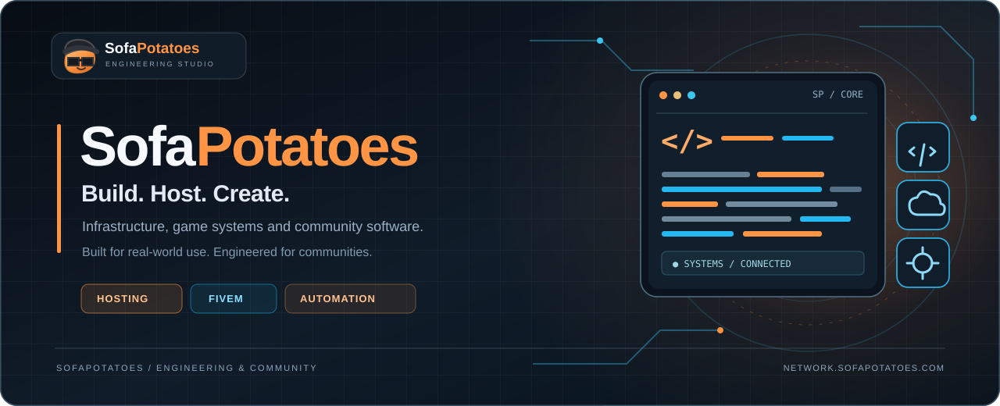

<!-- SofaPotatoes public GitHub organization profile -->

  

   

  <h3>為社群打造穩定基礎，也為創作者實現更多可能。</h3>
  

    Independent engineering studio building infrastructure, game systems and community software. 
    從主機環境、遊戲體驗到日常營運工具，我們重視實際使用感受與長期維護。
  

  

    <a href="https://network.sofapotatoes.com/"><strong>Explore SofaPotatoes ↗</strong></a>
    &nbsp;&nbsp;·&nbsp;&nbsp;
    <a href="https://github.com/sofapotatoes?tab=repositories">Repositories ↗</a>
  

 

## What we build / 我們的領域

<table>
  <tr>
    <td width="33%" valign="top">
      01 / INFRASTRUCTURE
      <h3>Hosting & Operations</h3>
      
獨立主機、遊戲伺服器架設與基礎設施維運，讓每一個社群都有可靠的運作環境。

      
Dedicated hosting · Server operations · Monitoring

    </td>
    <td width="33%" valign="top">
      02 / GAME EXPERIENCES
      <h3>FiveM Development</h3>
      
打造貼合玩家需求的遊戲系統、互動介面與客製化資源，兼顧效能和沉浸感。

      
Game systems · Interface design · Integrations

    </td>
    <td width="33%" valign="top">
      03 / COMMUNITY SOFTWARE
      <h3>Tools & Automation</h3>
      
串接 Discord、後端服務與管理流程，減少重複工作，讓營運更清晰有效率。

      
Discord tooling · Backend services · Workflows

    </td>
  </tr>
</table>

## Our approach / 工程理念

**Built for real-world use.** 我們不只追求功能完成，更重視系統的可維護性、清楚的權限界線與部署後的實際體驗。

- **Dependable by design** — 將穩定性、資安與可觀測性納入系統設計。
- **Details matter** — 從 API 行為到使用介面的細節，都保持一致、可理解。
- **Community first** — 根據營運者與玩家的真實需求持續改善。

## About this GitHub / 關於這個組織

This is the official GitHub organization of **SofaPotatoes**. We share public projects and development resources here when they are ready for release.

此頁為 SofaPotatoes 官方 GitHub 組織首頁。部分商用產品與營運系統採私人儲存庫維護；**公開展示不代表程式碼已開源**。如需使用公開專案，請以各儲存庫實際提供的授權條款為準。

---

  <h3>Have something to build?</h3>
  
主機服務、FiveM 開發或系統整合需求，歡迎透過官方網站與我們聯繫。

  
<a href="https://network.sofapotatoes.com/"><strong>Visit the official website →</strong></a>

  SofaPotatoes · Build. Host. Create.

